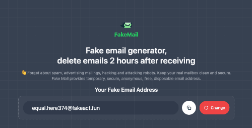

# Fake Mail - The free temporary email service



📪 Website: [https://mail.fakeact.fun](https://mail.fakeact.fun)

## Fake email generator, delete emails 2 hours after receiving

This is a temporary email service that uses Cloudflare Workers to create a temporary email address and view the received email in web browser.

` /app ` - Astro ssr

` /mailbox ` - Cloudflare Worker

## Multiple email addresses

use [clerk](https://clerk.com/) to login && register

Data is stored encrypted on cloudflare D1

## Logged-in MCP

After you sign in, Fake Mail exposes its own MCP server for that Clerk user. This is the product endpoint, not [Clerk's dashboard MCP](https://mcp.clerk.com/mcp).

- Endpoint: `https://mail.fakeact.fun/mcp`
- Transport: Streamable HTTP (POST). No browser session cookie. An unauthenticated `GET` returns `401` with the same `WWW-Authenticate` Bearer challenge as a `tools/call` that has no token. `initialize` and `tools/list` still work without a token. A `GET` that already has an `Authorization` header is still verified by Clerk before it reaches the streamable transport.
- Auth: Clerk OAuth. A client that receives `401` follows `/.well-known/oauth-protected-resource/mcp` to this site's Clerk instance, opens a browser so you can sign in and approve access, then retries with a bearer token. The token audience is the MCP URL above and the scope is `profile`. Older clients can also read `/.well-known/oauth-authorization-server`.
- Anonymous 2-hour addresses (KV `/api/get`) are not available here. Only mailboxes stored for the signed-in user are.

Connect with any MCP client that supports Streamable HTTP and OAuth, for example:

```json
{
  "mcpServers": {
    "fakemail": {
      "url": "https://mail.fakeact.fun/mcp"
    }
  }
}
```

Tools, all read-only:

| Tool | Input | Output |
| --- | --- | --- |
| `list_mailboxes` | `{}` | `{ mailboxes: [{ id, email_address, alias, created_at }] }` |
| `list_messages` | `{ id }` mailbox id | `{ mailbox_id, messages: [{ message_id, subject, sender, senderName, cc, received_at, is_read }] }` (no body) |
| `get_message` | `{ message_id }` | `{ message: { message_id, subject, sender, senderName, cc, content, received_at, is_read } }` |

`content` is the plain-text body when the message has one, otherwise the HTML body. The same fields are returned by `GET /api/getMails`. `get_message` does not mark the message read.

The signed-in settings page shows the URL for the deployment you are on and a prompt you can copy into an AI agent (Cursor, Claude, ChatGPT, or another MCP client). For local development, set `MCP_RESOURCE_URL` to the exact dev URL, such as `http://localhost:4321/mcp`, in `app/.env` or the worker vars. The production default is `https://mail.fakeact.fun/mcp`.

Before clients can finish sign-in on a deployed site, add that exact URL once in the Clerk Dashboard for the same Clerk application this site uses: Agents → MCP servers → Add MCP server. That turns on the `aud` claim. Allow public clients if the dashboard asks. No new Cloudflare secret is required when `PUBLIC_CLERK_PUBLISHABLE_KEY` and `CLERK_SECRET_KEY` are already set.

## License

Fake Mail is licensed under the [MIT License](https://github.com/CH563/fakemail/blob/main/LICENSE).